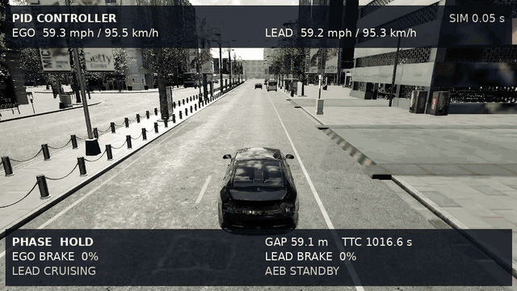
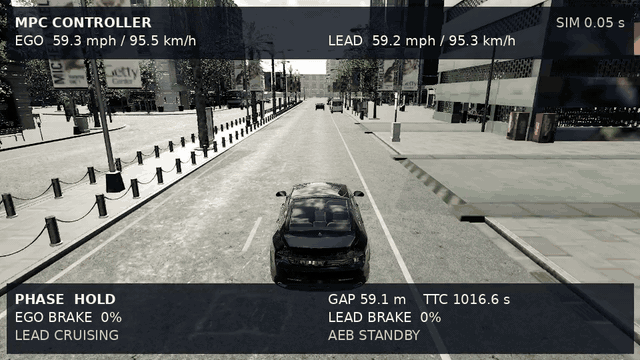
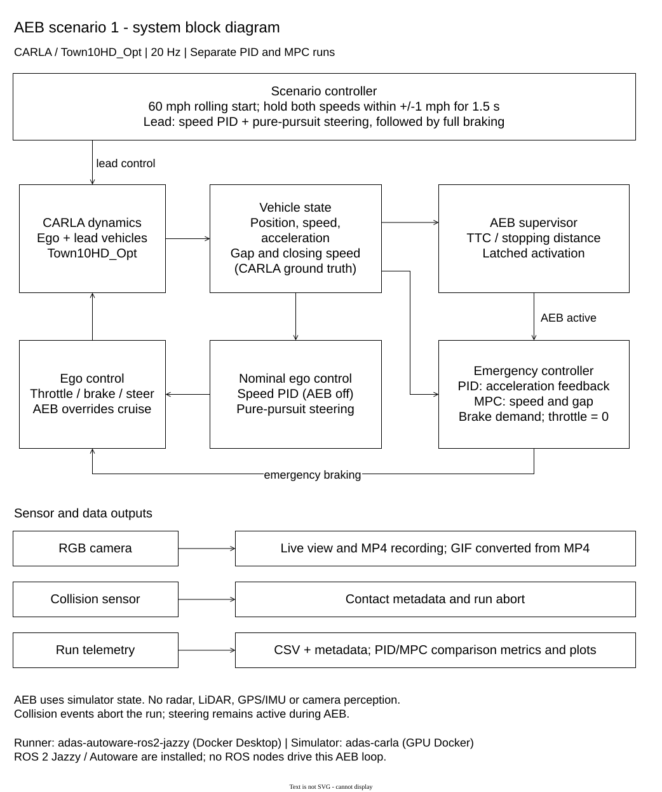

# Scenario 1 — 60 mph lead vehicle sudden braking

This directory contains the reviewed CARLA PID/MPC comparison recorded on **16 October 2026**. Both vehicles approach 60 mph, the lead vehicle applies full braking, and the ego vehicle responds through the common AEB supervisor and the selected PID or MPC brake controller. These are newly recorded simulator outputs; existing CSV files were not used to drive the experiment.

Both runs completed with positive measured gaps and **zero collision sensor contacts**. The saved comparison reports matching provenance and matching observations through the first AEB activation, with `comparison_valid=true`.

## Videos and graph data

| PID — Scenario 1 | MPC — Scenario 1 |
|---|---|
|  |  |

The embedded GIFs show the complete recorded clips, converted to **640 × 360 at 10 fps** and set to loop. The original **960 × 540, 20 fps** MP4 recordings are linked below for full-resolution playback.

| Output | PID | MPC |
|---|---|---|
| Chase camera video | [Watch/download PID MP4](town10_aeb_pid.mp4) | [Watch/download MPC MP4](town10_aeb_mpc.mp4) |
| Recorded time series | [PID CSV](town10_aeb_pid.csv) | [MPC CSV](town10_aeb_mpc.csv) |
| Run evidence and provenance | [PID metadata](town10_aeb_pid.metadata.json) | [MPC metadata](town10_aeb_mpc.metadata.json) |

Use [summary.csv](comparison/summary.csv) for a bar chart with one row per controller. Its `source_csv` paths are relative to the `comparison/` directory. Use the individual traces for time plots: `time_s` is the horizontal axis; `ego_speed_mph`, `target_speed_mph`, `distance_m`, `ttc_s`, `brake_percent`, and `ego_accel_mps2` are recorded measurements or commands. `inf` TTC means the vehicles are not closing sufficiently for a finite TTC; leave those points blank when plotting. Empty summary measurements mean unavailable, not zero. Controller execution time was not recorded in this pair.

The [Markdown report](comparison/comparison.md), [JSON report](comparison/comparison.json), and [SVG figure](comparison/comparison.svg) provide the same comparison in other formats. The videos include speed, gap, braking, and AEB overlays. Video frame zero corresponds to the first CSV sample; subsequent frames correspond to subsequent rows.


## Scenario setup

| Setting | Recorded configuration |
|---|---|
| CARLA client and server | 0.10.0 |
| Map and route | `Town10HD_Opt`, spawn index **105**, common fixed lane route |
| Simulation step | Synchronous, **0.05 s**; 20 observations per simulated second |
| Ego vehicle | Lincoln MKZ, `vehicle.lincoln.mkz` |
| Lead vehicle | Dodge Charger, `vehicle.dodge.charger` |
| Requested cruise speed | **60 mph** for both vehicles, approximately 96.6 km/h |
| Nominal placement gap | **55 m** configured; first recorded measured gap **59.060 m** |
| Lead braking trigger | Both speeds within **±1 mph** of their targets for **1.5 s** |
| Lead braking command | **100% brake**, zero throttle |
| Stop measurement | First ego sample at or below **1 mph** after AEB; a further **1 s** stop hold is required to complete the scenario |

The [saved preview configuration](preview_config.json) records the settings used for this pair; [config.json](config.json) is the reusable scenario configuration. All Scenario 1 recordings, comparison outputs, and configuration files are kept in this `AEB scenario 1/` directory. Shared controller and recording code remains in the repository's [source directory](../src/town10_adas/) and [scripts directory](../scripts/). Each controller run reloads the world and uses the same route, vehicle settings, cruise controllers, and safety supervisor.

This scenario uses a rolling start. After 20 settling ticks, each vehicle receives one initial velocity assignment and a warmup tick. Subsequent motion follows CARLA physics and controller commands. Manual cruise gears are held at **5 for the ego** and **6 for the lead**. The cruise controller throttle is initialized to **0.35** and **0.80**, respectively; these are initial values, not fixed throttle throughout the run. The actual measured speeds below document the result of that initialization.

## Control flow



[Open the editable draw.io diagram](architecture.drawio). The arrows show live
vehicle state and control commands; CSV files are generated outputs for the
subsequent comparison. Open the `.drawio` file in draw.io to edit the diagram.

## Sensors and controller inputs

| Component | Configuration and role |
|---|---|
| RGB camera | `sensor.camera.rgb`, **960 × 540**, **20 fps**, **90° field of view**. Rigid ego chase mount at **(x, y, z) = (−7, 0, 3.5) m**, pitch **−15°**. Supplies the live view and MP4 recording only; image pixels do not enter the controller. |
| Ego collision sensor | `sensor.other.collision`, attached to the ego. Records contact events and supports run termination on contact. It does not detect the lead vehicle for AEB or compute the brake demand. Both saved metadata files contain zero contacts. |
| Vehicle state | CARLA actor positions and velocity magnitudes supply the measured gap and speeds. CARLA actor acceleration, projected along velocity, supplies PID deceleration feedback and the acceleration trace. |
| Lateral guidance | CARLA map waypoints and actor pose feed the shared pure pursuit steering controller. |

Gap is computed as Euclidean center distance minus the two longitudinal bounding box half-lengths; this is an approximation on curved roads. Closing speed is the positive ego-minus-lead speed difference, and TTC is gap divided by closing speed when closing speed is positive enough. These are calculations from simulator ground truth.

**Radar, lidar, GNSS, IMU, and camera object detection are not used in this scenario.** ROS 2 Jazzy and Autoware are installed in the Docker container, but this run executes the repository's Python CARLA adapter and controller core directly. ROS/Autoware nodes do not execute the braking algorithm in this recorded pair.

The common supervisor latches AEB on its TTC condition or its stopping-distance-plus-margin condition. The configured TTC thresholds are **3 s for FCW** and **2 s for AEB**, with a **5 m** distance margin and **8 m/s²** stopping-distance deceleration assumption. Here the distance condition triggers AEB at a recorded TTC of **4.506 s**. FCW is also asserted when AEB latches, so both flags first appear at the same sample. PID then uses acceleration feedback; MPC uses ego speed, lead speed, and gap to choose braking.

## Recorded event timeline

Times are elapsed simulation times from the CSV. The PID and MPC observations are identical through AEB activation at the reported precision.

| Event | Time (s) | Ego speed (mph) | Lead speed (mph) | Measured gap (m) |
|---|---:|---:|---:|---:|
| First recorded sample, both runs | 0.050 | 59.316 | 59.186 | 59.060 |
| Lead applies full brake, both runs | 1.550 | 59.941 | 60.166 | 59.107 |
| First FCW and AEB, both runs | 3.300 | 59.938 | 35.299 | 49.629 |
| PID first sample at or below 1 mph | 7.750 | 0.655 | 0.000 | 9.283 |
| MPC first sample at or below 1 mph | 8.100 | 0.998 | 0.000 | 15.252 |
| PID complete after stop hold | 8.750 | 0.000 | 0.000 | 9.272 |
| MPC complete after stop hold | 9.100 | 0.000 | 0.000 | 15.133 |

## Measured comparison

| Metric | PID | MPC | MPC minus PID |
|---|---:|---:|---:|
| Samples | 175 | 182 | 7 |
| Speed at AEB (mph) | 59.938 | 59.938 | 0.000 |
| Gap at AEB (m) | 49.629 | 49.629 | 0.000 |
| Minimum measured gap (m) | 9.272 | 15.133 | +5.861 |
| Minimum finite TTC (s) | 1.763 | 2.564 | +0.801 |
| AEB to 1 mph stop threshold (s) | 4.450 | 4.800 | +0.350 |
| Distance from AEB to stop threshold (m) | 60.032 | 54.057 | −5.975 |
| Peak deceleration, finite difference (m/s²) | 7.063 | 7.519 | +0.456 |
| Peak absolute jerk, finite difference (m/s³) | 77.606 | 57.579 | −20.027 |
| Collision sensor contacts | 0 | 0 | 0 |

In this pair, MPC leaves a larger minimum gap and travels a shorter distance after AEB, while taking 0.350 s longer to reach the 1 mph threshold. Its peak deceleration is higher and its measured peak absolute jerk is lower. These different outcomes do not establish an overall winner.

Stopping distance integrates ego speed from the first AEB sample to the first sample at or below 1 mph using trapezoids. Peak deceleration and jerk use unsmoothed finite differences of the rounded CSV speeds, so they depend on the 0.05 s sampling interval and quantization. The stop metric does not mean exact zero velocity. Collision evidence comes from the metadata sensor events; positive gap alone is not contact evidence.

The comparison checks shared settings, controller identities, source hashes, CSV hashes, and observations through AEB activation with an absolute tolerance of **0.001**. Both traces must complete without contact or gap overlap for the reported comparison to be valid. The raw recordings and metadata are preserved; the comparison reports have been regenerated for this archive. Original staging paths in metadata are historical provenance, while the links here point to the archived files. The [artifact manifest](artifact_manifest.json) records the archived artifacts. This is one paired simulator demonstration with ideal vehicle-state information; it provides neither statistical significance, perception validation, nor road safety certification.

## Reproduce and review before saving

From the repository root, with the local [Docker workflow prerequisites](../README.md#docker-desktop-workflow) installed:

```bash
bash scripts/docker.sh simulator
bash scripts/docker.sh start
bash scripts/docker.sh preview \
  --config 'AEB scenario 1/config.json' --spawn-index 105
```

Open **http://localhost:8765**, select **Start comparison**, and watch the live run. Review both videos, the CSV measurements, and the graphs, then select **Save results**. A fresh run is staged under `.runtime/`; saving creates a new `results/run_...` directory. The simulator generates new measurements without reading these archived traces as inputs.

To regenerate the comparison from the Scenario 1 recordings without running CARLA, use the Docker container's Python environment and write the regenerated report to a separate directory:

```bash
bash scripts/docker.sh exec python scripts/compare_aeb_results.py \
  --pid 'AEB scenario 1/town10_aeb_pid.csv' \
  --mpc 'AEB scenario 1/town10_aeb_mpc.csv' \
  --output-dir .runtime/scenario_1_recomputed
```

This produces summary CSV, JSON, Markdown, PNG, and SVG outputs using the saved traces and their metadata sidecars. The [preview log](preview.log) is also retained with this archive.
