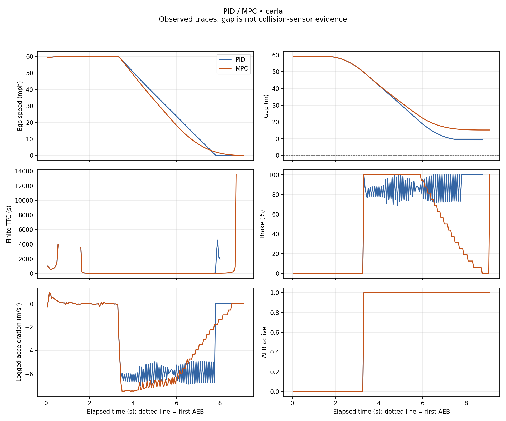

# PID and MPC AEB comparison

**Source:** carla

**Status:** VALID PAIRED COMPARISON

| Metric | PID | MPC | MPC − PID |
|---|---:|---:|---:|
| Samples | 175 | 182 | — |
| Observed duration (s) | 8.7000 | 9.0500 | — |
| Speed at AEB (mph) | 59.9380 | 59.9380 | — |
| Gap at AEB (m) | 49.6290 | 49.6290 | — |
| Minimum gap (m) | 9.2720 | 15.1330 | 5.8610 |
| Minimum finite TTC (s) | 1.7630 | 2.5640 | 0.8010 |
| AEB to stop threshold (s) | 4.4500 | 4.8000 | 0.3500 |
| AEB to stop threshold (m) | 60.0324 | 54.0574 | -5.9750 |
| Peak deceleration, finite difference (m/s²) | 7.0632 | 7.5192 | 0.4560 |
| Peak absolute jerk, finite difference (m/s³) | 77.6061 | 57.5788 | -20.0274 |
| Gap ≤ 0 proxy | False | False | — |
| Collision sensor contact | False | False | — |
| Final phase | COMPLETE | COMPLETE | — |
| Outcome | completed_with_positive_gap | completed_with_positive_gap | — |

Stop threshold: **1 mph**. Distance integrates ego speed from first AEB.

- **PID events (s):** FCW 3.3000; threat 1.5500; AEB 3.3000; stop 7.7500. Controller runtime (ms): unavailable.
- **MPC events (s):** FCW 3.3000; threat 1.5500; AEB 3.3000; stop 8.1000. Controller runtime (ms): unavailable.

No overall winner: gap, response and comfort trade off. Deltas require complete, matched, documented runs.

## Measurement limits

- CARLA traces use simulator ground-truth vehicle state; they do not validate sensor perception or road safety.
- Gap <= 0 is an overlap proxy; contact requires separate sensor evidence.
- TTC assumes constant relative motion; nonclosing TTC is unavailable.
- Finite differences are unsmoothed and depend on sampling and speed quantization.
- Stop is the first sample at or below the speed threshold, not exact zero; distance uses trapezoids.
- One paired run does not establish statistical significance.

## Traces

[Download SVG](comparison.svg)
