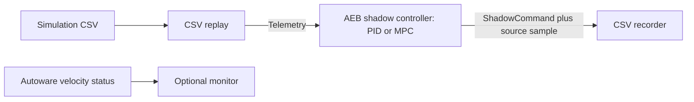

# ADAS in Autonomous Car

Reproducible **PID versus MPC automatic emergency braking (AEB)** experiments, a
shared safety supervisor, a CARLA adapter, and ROS 2 Jazzy nodes.

**Target system: Windows → WSL2 → Ubuntu 24.04 + ROS 2 Jazzy + Autoware,
with CARLA running in Docker.** Start with the
[WSL2 / Autoware / Docker setup guide](docs/wsl2_autoware.md).

## Comparative results

**[View the six-case comparison, raw data, and plots →](results/model/README.md)**

| Evidence | Status |
|---|---|
| Deterministic 1-D model | Six paired scenarios: 15/10, 25/15, 35/20, 50/25 mph, reduced grip, delayed braking |
| CARLA Town10 | Runner with provenance and contact checks; canonical CSVs remain empty placeholders |
| ROS 2 | Typed telemetry, PID/MPC shadow controller, recorder, replay launch, optional Autoware monitor |

The checked-in results are outputs of the disclosed **1-D model**, not CARLA or
road measurements. Reports compare stopping time/distance, minimum gap/TTC, peak
deceleration, and jerk. They check matched pre-AEB inputs and retain invalid runs
as failures. The six cases are a parameter sweep, not statistical repetitions.

```bash
python3 -m venv .venv
source .venv/bin/activate
python3 -m pip install -e '.[plots]'
python3 scripts/run_model_benchmark.py --allow-stress-failures
python3 -m unittest discover -s tests -v
```

Standard-library-only reproduction:

```bash
python3 scripts/run_model_benchmark.py --output-dir /tmp/adas-model --no-plots --allow-stress-failures
```

Compare existing files using their `.metadata.json` sidecars:

```bash
python3 scripts/compare_aeb_results.py \
  --pid results/model/urban_15_10/pid.csv \
  --mpc results/model/urban_15_10/mpc.csv \
  --output-dir /tmp/adas-comparison
```

See [model assumptions](docs/model_benchmark.md) and
[metric definitions and integrity checks](docs/comparison_methodology.md).

Both controllers reach overlap in the reduced-grip and delayed-braking stress
cases. The flag above permits those documented failures during reproduction;
their reports remain invalid and visible.

## ROS 2 nodes

The standalone packages install the same controller core used by the simulation
backends. Autoware is needed only for the optional velocity monitor.



```bash
source /opt/ros/jazzy/setup.bash
cd ros2_ws
colcon build --symlink-install --packages-up-to town10_adas_ros
source install/setup.bash
```

**[ROS 2 launch commands, topics, QoS, and runtime validation](docs/ros2_nodes.md)**

The controller publishes shadow brake recommendations. Replay does not apply
these recommendations to a vehicle, so replay alone cannot measure closed-loop
stopping performance.

## CARLA experiment

The adapter targets **CARLA 0.10.0**, **Town10HD_Opt**, and the configured vehicle
blueprints. It directly controls its own `scenario_ego` and lead actors. An
external controller must not command the same actor.

Edit [config/town10_adas.json](config/town10_adas.json) for your host and scenario;
the default address is `127.0.0.1:2000`, the CARLA Docker port published to WSL.
Use `--host` and `--port` to override it for your Docker network.

```bash
python3 scripts/check_carla_integration.py
python3 scripts/run_town10_adas.py --controller both
python3 scripts/compare_aeb_results.py \
  --pid results/town10_aeb_pid.csv \
  --mpc results/town10_aeb_mpc.csv \
  --output-dir results/carla_comparison
```

Read [CARLA run integrity and validation](docs/carla_validation.md) before
interpreting results. Traffic, route geometry, contacts, and physics need separate
validation. Empty CARLA placeholders are rejected by the analyzer; model runs
never overwrite them.

## Control design

| Component | Role |
|---|---|
| Pure Pursuit | Bounded steering along the CARLA fixed lane route |
| Speed PID | Normal CARLA ego/lead speed regulation |
| Safety supervisor | Shared FCW/TTC and stopping-distance thresholds; latched AEB |
| AEB PID | Feedback tracking of requested emergency deceleration |
| AEB MPC | Enumerated constant-deceleration actions over a receding 1-D horizon |
| Scenario | `ACCELERATE → HOLD → THREAT → AEB → COMPLETE`, or explicit `ABORTED` |

The MPC is a lightweight discrete-action predictive controller; its simplified
model does not establish superiority over PID in all conditions. Each model pair
shares its supervisor, time step, initial conditions, and lead behavior.

CSV units: speeds **mph**, distance **m**, time **s**, acceleration **m/s²**, brake
**percent**. ROS messages use SI speeds and brake percentages. The original
12-column CSV schema is preserved.

## Validation

Tests cover bounds, invalid inputs, overlap-triggered AEB, state transitions,
repeatable model runs, comparison integrity, and metric edge cases. CI runs the
Python tests, reproduces the model suite, and builds standalone ROS packages.
Live CARLA validation remains separate. Local validation passed **36 Python tests**,
the **four-package Jazzy/Autoware build**, and real DDS replay checks for PID and
MPC (288 source rows each, with stale/duplicate/NaN/watchdog/recovery checks).
Replay checks passed with both Cyclone DDS and Fast DDS.
The Autoware VelocityReport monitor also passed its DDS check.

The historical [cruise-only analysis](docs/baseline_csv_analysis.md) is retained;
it is not evidence of emergency braking. See [architecture](docs/system_architecture.md).
