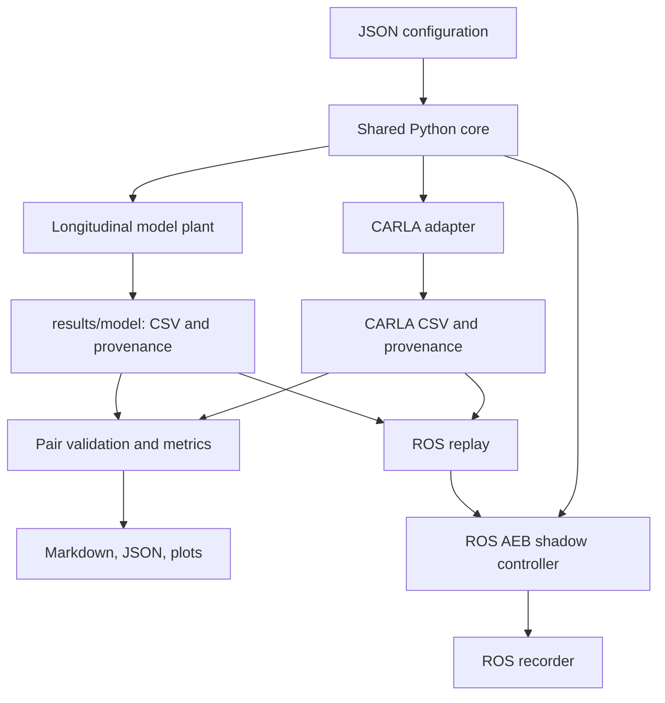

# System architecture

`src/town10_adas` contains controller math, the safety supervisor, orchestration,
CSV logging, model simulation, and metrics. The math and model do not import ROS
or CARLA. Both adapters use the same core.

## Command authority

The CARLA adapter commands its own actors. The model runner commands its local
plant. The ROS shadow controller produces recommendations without commanding
CARLA or Autoware. The optional Autoware monitor only subscribes to vehicle status.

## Fair comparisons

Model pairs share settings and initial conditions. Source/CSV hashes identify
inputs. The comparison layer validates time ordering, numbers, event/completion
status, provenance, and pre-AEB observations. Invalid pairs remain diagnostics.

CARLA pairs also need matching route/spawn/environment provenance and contact
observations. Matching metadata cannot eliminate nondeterministic traffic or
establish physical safety. See the CARLA validation guide.

## ROS packaging

`town10_adas_core` installs the shared Python source without duplicating the
algorithm. `town10_adas_interfaces` defines typed messages. `town10_adas_ros`
installs replay/controller/recorder executables and launch files. The optional
`town10_adas_monitor` remains a separate Autoware-dependent package.
