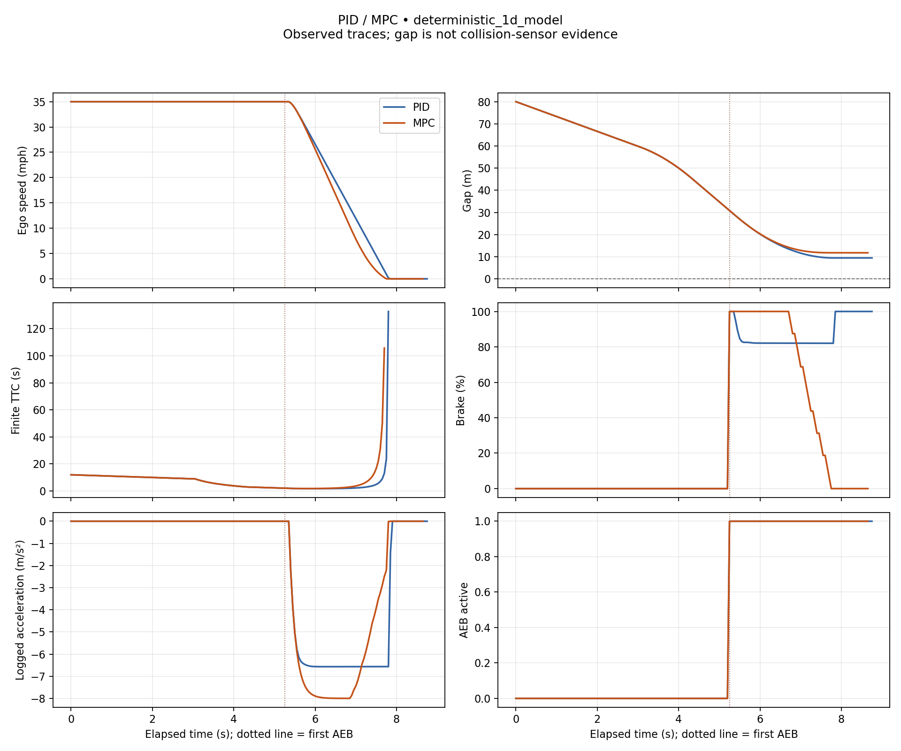

# PID and MPC AEB comparison

**Source:** deterministic_1d_model

**Status:** VALID PAIRED COMPARISON

Measured outputs of the simplified longitudinal model. These are not CARLA or physical vehicle results.

| Metric | PID | MPC | MPC − PID |
|---|---:|---:|---:|
| Samples | 176 | 174 | — |
| Observed duration (s) | 8.7500 | 8.6500 | — |
| Speed at AEB (mph) | 35.0000 | 35.0000 | — |
| Gap at AEB (m) | 30.8357 | 30.8357 | — |
| Minimum gap (m) | 9.4346 | 11.7624 | 2.3278 |
| Minimum finite TTC (s) | 1.6950 | 1.7472 | 0.0522 |
| AEB to stop threshold (s) | 2.5000 | 2.3500 | -0.1500 |
| AEB to stop threshold (m) | 21.3889 | 19.0464 | -2.3426 |
| Peak deceleration, finite difference (m/s²) | 6.5693 | 7.9996 | 1.4304 |
| Peak absolute jerk, finite difference (m/s³) | 102.8731 | 45.3550 | -57.5181 |
| Gap ≤ 0 proxy | False | False | — |
| Collision sensor contact | unavailable | unavailable | — |
| Final phase | COMPLETE | COMPLETE | — |
| Outcome | completed_with_positive_gap | completed_with_positive_gap | — |

Stop threshold: **1 mph**. Distance integrates ego speed from first AEB.

- **PID events (s):** FCW 4.3000; threat 3.0500; AEB 5.2500; stop 7.7500. Controller runtime (ms): unavailable.
- **MPC events (s):** FCW 4.3000; threat 3.0500; AEB 5.2500; stop 7.6000. Controller runtime (ms): unavailable.

No overall winner: gap, response and comfort trade off. Deltas require complete, matched, documented runs.

## Measurement limits

- Model traces are controller experiments, not CARLA or road validation.
- Gap <= 0 is an overlap proxy; contact requires separate sensor evidence.
- TTC assumes constant relative motion; nonclosing TTC is unavailable.
- Finite differences are unsmoothed and depend on sampling and speed quantization.
- Stop is the first sample at or below the speed threshold, not exact zero; distance uses trapezoids.
- One paired run does not establish statistical significance.

## Traces

[Download SVG](comparison.svg)
