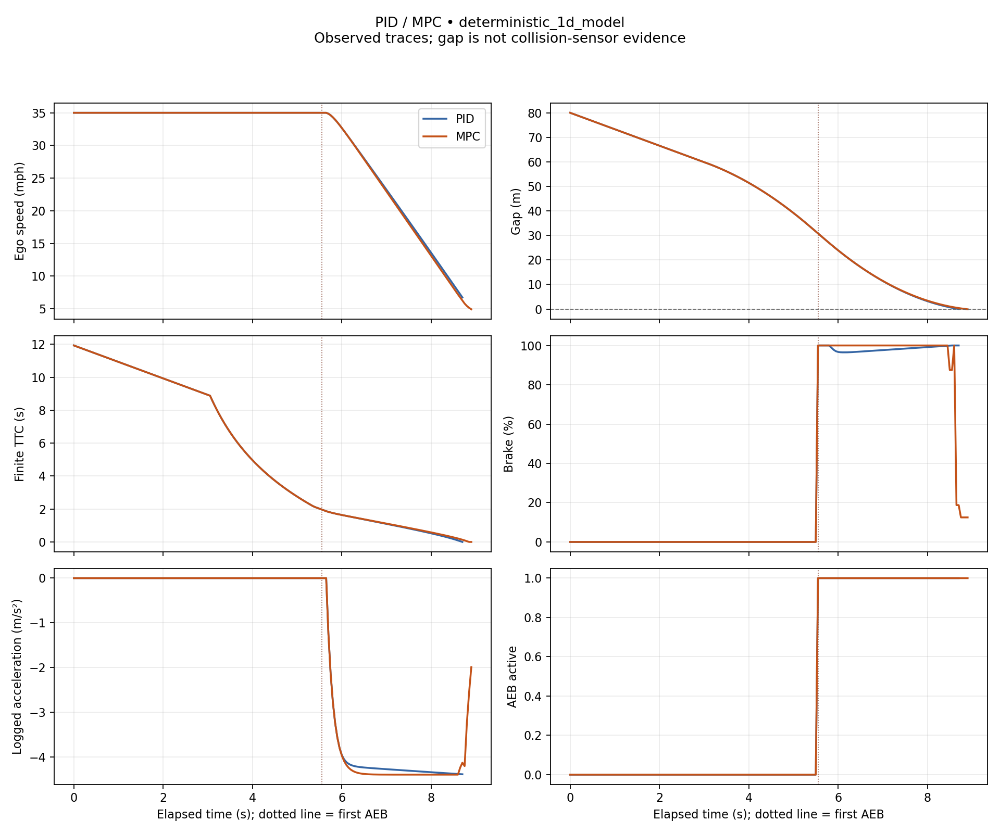

# PID and MPC AEB comparison

**Source:** deterministic_1d_model

**Status:** DIAGNOSTICS ONLY — COMPARISON INVALID

Measured outputs of the simplified longitudinal model. These are not CARLA or physical vehicle results.

Invalidity reasons: pid:aborted_run, pid:no_stop_after_aeb, pid:gap_overlap_proxy, mpc:aborted_run, mpc:no_stop_after_aeb, mpc:gap_overlap_proxy

| Metric | PID | MPC | MPC − PID |
|---|---:|---:|---:|
| Samples | 175 | 179 | — |
| Observed duration (s) | 8.7000 | 8.9000 | — |
| Speed at AEB (mph) | 35.0000 | 35.0000 | — |
| Gap at AEB (m) | 30.8135 | 30.8135 | — |
| Minimum gap (m) | -0.0035 | -0.1115 | unavailable |
| Minimum finite TTC (s) | 0.0000 | 0.0000 | unavailable |
| AEB to stop threshold (s) | unavailable | unavailable | unavailable |
| AEB to stop threshold (m) | unavailable | unavailable | unavailable |
| Peak deceleration, finite difference (m/s²) | 4.3921 | 4.4000 | unavailable |
| Peak absolute jerk, finite difference (m/s³) | 24.9452 | 24.9452 | unavailable |
| Gap ≤ 0 proxy | True | True | — |
| Collision sensor contact | unavailable | unavailable | — |
| Final phase | ABORTED | ABORTED | — |
| Outcome | aborted | aborted | — |

Stop threshold: **1 mph**. Distance integrates ego speed from first AEB.

- **PID events (s):** FCW 4.9000; threat 3.0500; AEB 5.5500; stop unavailable. Controller runtime (ms): unavailable.
- **MPC events (s):** FCW 4.9000; threat 3.0500; AEB 5.5500; stop unavailable. Controller runtime (ms): unavailable.

No overall winner: gap, response and comfort trade off. Deltas require complete, matched, documented runs.

## Measurement limits

- Model traces are controller experiments, not CARLA or road validation.
- Gap <= 0 is an overlap proxy; contact requires separate sensor evidence.
- TTC assumes constant relative motion; nonclosing TTC is unavailable.
- Finite differences are unsmoothed and depend on sampling and speed quantization.
- Stop is the first sample at or below the speed threshold, not exact zero; distance uses trapezoids.
- One paired run does not establish statistical significance.

## Traces

[Download SVG](comparison.svg)
