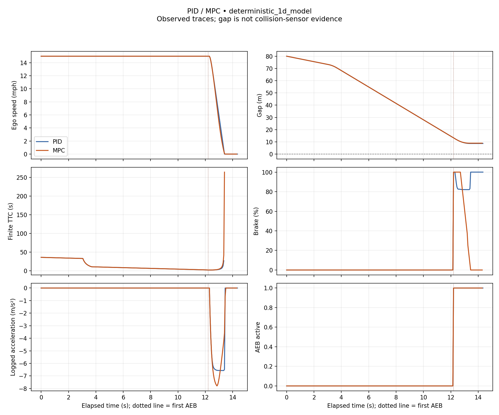

# PID and MPC AEB comparison

**Source:** deterministic_1d_model

**Status:** VALID PAIRED COMPARISON

Measured outputs of the simplified longitudinal model. These are not CARLA or physical vehicle results.

| Metric | PID | MPC | MPC − PID |
|---|---:|---:|---:|
| Samples | 288 | 287 | — |
| Observed duration (s) | 14.3500 | 14.3000 | — |
| Speed at AEB (mph) | 15.0000 | 15.0000 | — |
| Gap at AEB (m) | 13.2539 | 13.2539 | — |
| Minimum gap (m) | 8.6612 | 8.8982 | 0.2369 |
| Minimum finite TTC (s) | 1.8584 | 1.8584 | 0.0000 |
| AEB to stop threshold (s) | 1.1500 | 1.1000 | -0.0500 |
| AEB to stop threshold (m) | 4.5846 | 4.3334 | -0.2512 |
| Peak deceleration, finite difference (m/s²) | 6.5693 | 7.7955 | 1.2262 |
| Peak absolute jerk, finite difference (m/s³) | 129.4817 | 58.2344 | -71.2473 |
| Gap ≤ 0 proxy | False | False | — |
| Collision sensor contact | unavailable | unavailable | — |
| Final phase | COMPLETE | COMPLETE | — |
| Outcome | completed_with_positive_gap | completed_with_positive_gap | — |

Stop threshold: **1 mph**. Distance integrates ego speed from first AEB.

- **PID events (s):** FCW 11.2000; threat 3.0500; AEB 12.2000; stop 13.3500. Controller runtime (ms): unavailable.
- **MPC events (s):** FCW 11.2000; threat 3.0500; AEB 12.2000; stop 13.3000. Controller runtime (ms): unavailable.

No overall winner: gap, response and comfort trade off. Deltas require complete, matched, documented runs.

## Measurement limits

- Model traces are controller experiments, not CARLA or road validation.
- Gap <= 0 is an overlap proxy; contact requires separate sensor evidence.
- TTC assumes constant relative motion; nonclosing TTC is unavailable.
- Finite differences are unsmoothed and depend on sampling and speed quantization.
- Stop is the first sample at or below the speed threshold, not exact zero; distance uses trapezoids.
- One paired run does not establish statistical significance.

## Traces

[Download SVG](comparison.svg)
